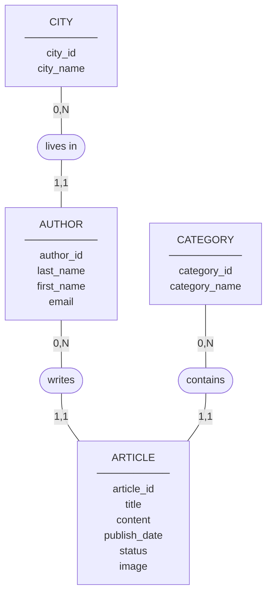

# Blog MCD

## 1. Complete Diagram

## 2. Entities and Fields

| Entity | Unique ID | Other fields |
|---|---|---|
| CITY | <u>city_id</u> | city_name |
| AUTHOR | <u>author_id</u> | last_name, first_name, email |
| ARTICLE | <u>article_id</u> | title, content, publish_date, status, image |
| CATEGORY | <u>category_id</u> | category_name |

## 3. Relationships

| Entity A | Number A | Relationship | Number B | Entity B |
|---|---|---|---|---|
| CITY | (0,N) | lives in | (1,1) | AUTHOR |
| AUTHOR | (0,N) | writes | (1,1) | ARTICLE |
| CATEGORY | (0,N) | contains | (1,1) | ARTICLE |

## 4. Simple Rules

- A city can have zero or many authors. Each author lives in one city.
- An author can write zero or many articles. Each article has one author.
- A category can have zero or many articles. Each article has one category.

## 5. Read the Numbers

- **(0,N):** Zero or many.
- **(1,1):** Exactly one.
